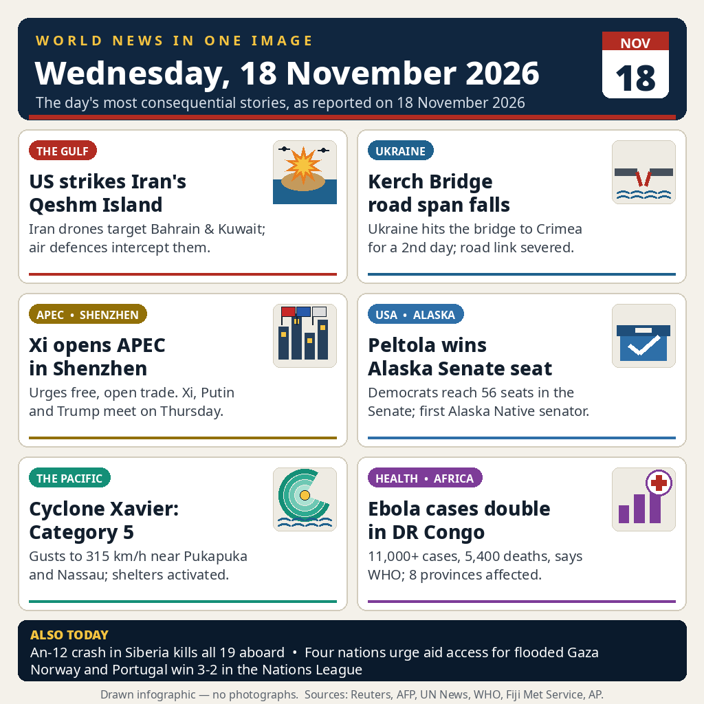

# news-image-20261118-kira

[](https://make.fun/bounty/news-image-20261118?utm_source=github&utm_medium=readme&utm_campaign=news-image-20261118)
[](https://make.fun/bounty/news-image-20261118/leaderboard?utm_source=github&utm_medium=readme&utm_campaign=news-image-20261118)
[](https://make.fun/bounty/news-image-20261118?utm_source=github&utm_medium=readme&utm_campaign=news-image-20261118)

One image summing up the world news of **Wednesday, 18 November 2026**:
a drawn newspaper-style poster naming the day, with six major stories
from six regions and fields, plus an "also today" strip.



## The stories

1. **The Gulf** — US jets strike an Iranian missile site on Qeshm Island;
   Iran fires drones at Bahrain and Kuwait; air defences intercept them.
2. **Ukraine** — Ukraine hits the Kerch Bridge to Crimea for a second day;
   the road span collapses and the road link is severed.
3. **APEC, Shenzhen** — Xi Jinping opens the APEC summit urging free and
   open trade; Xi, Putin and Trump are due to meet on Thursday.
4. **USA, Alaska** — Mary Peltola wins Alaska's Senate seat; Democrats
   reach 56 seats, and she becomes the first Alaska Native senator.
5. **The Pacific** — Category 5 Cyclone Xavier, gusts to 315 km/h, nears
   Pukapuka and Nassau in the Northern Cook Islands; shelters open.
6. **Health, Africa** — Ebola in DR Congo has more than doubled: 11,000+
   cases and 5,400 deaths across eight provinces, says the WHO.

Also today: an An-12 crash in Siberia kills all 19 aboard; four nations
urge aid access for flooded Gaza; Norway and Portugal win 3-2 in the
Nations League. Sources and dating notes are in [RESEARCH.md](RESEARCH.md).

## How it works

- `entry.png` — the finished poster (1024 x 1024, drawn programmatically).
- `render_poster.py` — the script that draws the poster with PIL and the
  Noto Sans fonts. Run it with `python3 render_poster.py` to regenerate
  `entry.png`. No photographs and no AI image generation were used.
- `main.py` — the competition entrypoint (Python standard library only).
  It copies `entry.png` to `/output/entry.png`, or to
  `$MAKEFUN_OUTPUT_DIR/entry.png` for a local run. It writes identical
  bytes on every run.

Local check:

```sh
mkdir -p out && MAKEFUN_OUTPUT_DIR=out python3 main.py
```

## License

MIT — see [LICENSE](LICENSE).

---

Built for the make.fun bounty "Sum up 18 November's world news in one image". Referral code: 3a433hx8
